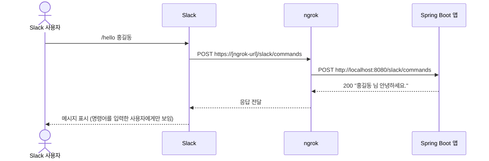

# Spring Boot Slack Slash Command Example

[](https://openjdk.org/projects/jdk/25/)
[](https://spring.io/projects/spring-boot)
[](https://gradle.org)
[](https://api.slack.com)
[](LICENSE)

Slack Slash Command를 처리하는 Spring Boot 애플리케이션 예제입니다.

## 프로젝트 개요

이 프로젝트는 Slack의 Slash Command 기능을 Spring Boot 백엔드와 통합하는 방법을 보여주는 예제 애플리케이션입니다. 사용자가 Slack에서 `/hello` 명령어를 입력하면, 서버가 이를 처리하고 응답을 반환합니다.

## 기술 스택

- **Java 25**
- **Spring Boot 4.1.1**
- **Gradle 9.8.2** (Gradle Wrapper 포함)
- **Slack API Client 1.39.0** (의존성만 선언되어 있고, 아직 코드에서 사용하지 않습니다)
- **Apache Commons Lang3**
- **Lombok**

> Spring Boot 3.x 기반 코드는 [`spring-boot-3x`](https://github.com/Pink-Spider/springboot-slack-slash-command-example/tree/spring-boot-3x) 브랜치에 있습니다.

## 프로젝트 구조

```
src/
├── main/
│   ├── java/io/pinkspider/example/
│   │   ├── SlackSlashCommandExampleApplication.java  # 메인 애플리케이션
│   │   └── controller/
│   │       └── SlackCommandController.java           # Slack 명령어 핸들러
│   └── resources/
│       └── application.yml                           # 애플리케이션 설정 (포트 8080)
└── test/
    └── java/io/pinkspider/example/
        └── SlackSlashCommandExampleApplicationTests.java
```

## 지원 명령어

| 입력 | 응답 |
|------|------|
| `/hello [이름]` | `[이름] 님 안녕하세요.` (예: `/hello 홍길동` → `홍길동 님 안녕하세요.`) |
| `/hello` (이름 없음) | `이름을 입력하세요. 사용법: /hello [이름]` |
| 그 밖의 명령어 | `알 수 없는 명령어입니다. 사용 가능한 명령어: /hello [문자]` |

응답 메시지는 명령어를 입력한 사용자에게만 보입니다. 자세한 내용은 [제한 사항](#제한-사항)을 참고하세요.

## 사전 준비

| 항목 | 용도 |
|------|------|
| JDK 25 | 빌드와 실행 |
| ngrok | Slack이 로컬 서버에 접근할 수 있게 함 |
| Slack 워크스페이스 | 앱을 만들고 설치할 수 있는 권한 필요 |

### JDK 25

`build.gradle`은 Java toolchain을 25로 지정합니다. Gradle은 PC에 설치된 JDK 25를 찾아서 컴파일합니다.

- PC에 JDK 25가 없으면, Gradle이 JDK 25를 자동으로 내려받습니다. `settings.gradle`의 foojay toolchain resolver 플러그인이 이 일을 합니다.
- `JAVA_HOME`이 다른 버전을 가리켜도 `./gradlew` 빌드는 동작합니다. Gradle 자체는 Java 17 이상에서 실행되고, 컴파일에는 JDK 25를 따로 씁니다.
- `java -jar`로 실행할 때는 `java` 명령이 Java 25 이상이어야 합니다. 더 낮은 버전으로 실행하면 `UnsupportedClassVersionError`가 발생합니다.

```bash
java -version   # 25 이상인지 확인
```

## 설치 및 실행

### 1. 프로젝트 빌드

```bash
./gradlew build
```

빌드가 끝나면 `build/libs/slack-slash-command-example-0.0.1-SNAPSHOT.jar` 파일이 생성됩니다.

### 2. 애플리케이션 실행

```bash
./gradlew bootRun
```

또는

```bash
java -jar build/libs/slack-slash-command-example-0.0.1-SNAPSHOT.jar
```

애플리케이션은 기본적으로 `http://localhost:8080`에서 실행됩니다.

### 3. 테스트 실행

```bash
./gradlew test
```

현재 테스트는 `contextLoads` 하나입니다. 이 테스트는 Spring 애플리케이션이 정상적으로 시작되는지만 확인합니다.

## 로컬에서 동작 확인하기

Slack 앱을 설정하기 전에, curl로 엔드포인트를 먼저 확인할 수 있습니다. 아래 명령은 Slack이 보내는 것과 같은 form 형식으로 요청을 보냅니다.

```bash
curl -X POST http://localhost:8080/slack/commands \
  --data-urlencode 'command=/hello' \
  --data-urlencode 'text=홍길동'
# 홍길동 님 안녕하세요.

curl -X POST http://localhost:8080/slack/commands \
  --data-urlencode 'command=/bye' \
  --data-urlencode 'text=홍길동'
# 알 수 없는 명령어입니다. 사용 가능한 명령어: /hello [문자]
```

JSON 형식으로 요청을 보내면 `415 Unsupported Media Type`이 반환됩니다. 엔드포인트는 `application/x-www-form-urlencoded` 형식만 받습니다.

## ngrok 설정

Slack은 HTTPS를 통해 외부에서 접근 가능한 URL이 필요합니다. 로컬 개발 환경에서는 **ngrok**을 사용하여 로컬 서버를 인터넷에 노출할 수 있습니다.

### ngrok이란?

ngrok은 로컬 서버를 인터넷에 안전하게 노출시켜주는 터널링 도구입니다. 로컬에서 실행 중인 애플리케이션에 외부에서 접근할 수 있는 공용 URL을 제공합니다.

### ngrok 설치

#### macOS

**Homebrew 사용 (권장)**
```bash
brew install ngrok
```

**직접 다운로드**
1. [ngrok 다운로드 페이지](https://ngrok.com/download)에서 macOS 버전을 다운로드합니다.
2. 다운로드한 zip 파일의 압축을 해제합니다.
3. ngrok 실행 파일을 `/usr/local/bin` 디렉토리로 이동합니다:
   ```bash
   sudo mv ngrok /usr/local/bin/
   ```

#### Windows

**Chocolatey 사용 (권장)**
```powershell
choco install ngrok
```

**Scoop 사용**
```powershell
scoop install ngrok
```

**직접 다운로드**
1. [ngrok 다운로드 페이지](https://ngrok.com/download)에서 Windows 버전을 다운로드합니다.
2. 다운로드한 zip 파일의 압축을 해제합니다.
3. `ngrok.exe` 파일을 원하는 디렉토리에 배치합니다.
4. (선택사항) 해당 디렉토리를 시스템 PATH 환경변수에 추가하면 어디서든 ngrok을 실행할 수 있습니다:
   - **시스템 속성** → **고급** → **환경 변수** → **Path** 편집 → ngrok이 있는 디렉토리 추가

### ngrok 계정 설정 (선택사항)

무료 계정을 생성하면 더 긴 세션 시간과 추가 기능을 사용할 수 있습니다.

```bash
# ngrok 계정 생성 후 authtoken 설정
ngrok config add-authtoken YOUR_AUTH_TOKEN
```

### ngrok 실행

```bash
ngrok http 8080
```

실행 후 터미널에 다음과 같은 출력이 표시됩니다:

```
Session Status                online
Account                       your-email@example.com
Version                       3.x.x
Region                        Japan (jp)
Forwarding                    https://xxxx-xxx-xxx-xxx-xxx.ngrok-free.app -> http://localhost:8080
```

`Forwarding`에 표시된 HTTPS URL (예: `https://xxxx-xxx-xxx-xxx-xxx.ngrok-free.app`)을 Slack 앱 설정에서 사용합니다.

## Slack 앱 설정

### 1. Slack 앱 생성

1. [Slack API](https://api.slack.com/apps)에 접속합니다.
2. **Create New App** 버튼을 클릭합니다.
3. **From scratch**를 선택합니다.
4. 앱 이름과 워크스페이스를 선택하고 생성합니다.

### 2. Slash Command 설정

1. 왼쪽 메뉴에서 **Slash Commands**를 선택합니다.
2. **Create New Command**를 클릭합니다.
3. 다음 정보를 입력합니다:
   - **Command**: `/hello`
   - **Request URL**: `https://[ngrok-url]/slack/commands`
   - **Short Description**: 인사말 명령어
   - **Usage Hint**: [이름]

### 3. 앱 설치

1. 왼쪽 메뉴에서 **Install App**을 선택합니다.
2. **Install to Workspace**를 클릭하여 워크스페이스에 앱을 설치합니다.

## API 엔드포인트

| Method | Endpoint | Content-Type | 설명 |
|--------|----------|--------------|------|
| POST | `/slack/commands` | `application/x-www-form-urlencoded` | Slack Slash Command 처리 |

모든 Slash Command는 이 엔드포인트 하나로 들어옵니다. 컨트롤러는 `command` 값을 보고 어떤 명령어인지 구분합니다.

### 요청 파라미터 (Slack에서 자동 전송)

이 예제가 읽는 파라미터는 다음과 같습니다.

| 파라미터 | 설명 |
|----------|------|
| `command` | 실행된 명령어 (예: `/hello`) |
| `text` | 명령어 뒤에 입력된 텍스트 |
| `user_id` | 명령어를 실행한 사용자 ID |
| `channel_id` | 명령어가 실행된 채널 ID |

Slack은 이 밖에도 `response_url`, `trigger_id`, `team_id`, `api_app_id` 등을 함께 보냅니다. 전체 목록은 [Slack 공식 문서](https://docs.slack.dev/interactivity/implementing-slash-commands)에 있습니다.

### 응답

- HTTP 상태 코드는 항상 `200`입니다.
- 응답 본문은 평문 문자열입니다. Slack은 이 문자열을 메시지로 보여 줍니다.
- 처리 중 예외가 발생해도 `200`과 함께 `명령어 처리 중 오류가 발생했습니다.` 문구를 반환합니다.

## 동작 흐름



## 새 명령어 추가하기

`/bye` 명령어를 추가하는 경우를 예로 듭니다.

1. Slack 앱 설정의 **Slash Commands**에서 `/bye` 명령어를 만듭니다. Request URL은 `/hello`와 같은 `https://[ngrok-url]/slack/commands`를 입력합니다.
2. `SlackCommandController.handleCommand`에 분기를 추가합니다.
   ```java
   if ("/bye".equalsIgnoreCase(StringUtils.trimToEmpty(command))) {
       return ResponseEntity.ok("안녕히 가세요.");
   }
   ```
3. 메서드 마지막의 "알 수 없는 명령어" 안내 문구에 `/bye`를 추가합니다.
4. 애플리케이션을 다시 시작하고 Slack에서 `/bye`를 입력해 확인합니다.

## 제한 사항

이 프로젝트는 학습용 예제입니다. 실제 서비스에 쓰려면 아래 내용을 먼저 보완해야 합니다.

- **요청 검증이 없습니다.** 지금은 누구나 이 엔드포인트를 호출할 수 있습니다. Slack이 보낸 요청인지 확인하려면 Signing Secret으로 요청 서명을 검증해야 합니다. 방법은 [Verifying requests from Slack](https://docs.slack.dev/authentication/verifying-requests-from-slack)에 있습니다.
- **3초 안에 응답해야 합니다.** Slack은 3000ms 안에 응답을 받지 못하면 사용자에게 `operation_timeout` 오류를 보여 줍니다. 오래 걸리는 작업을 추가하려면, 먼저 짧게 응답하고 결과는 요청의 `response_url`로 나중에 보내야 합니다.
- **응답은 입력한 사용자에게만 보입니다.** 평문 응답의 기본 `response_type`은 `ephemeral`입니다. 채널 전체에 보이게 하려면 JSON으로 `"response_type": "in_channel"`을 함께 보내야 합니다.
- **요청 전체를 로그로 남깁니다.** 컨트롤러는 받은 파라미터 전체를 INFO 로그로 기록합니다. 여기에는 Slack이 보내는 `token` 필드도 포함됩니다.

## Spring Boot 3 → 4 마이그레이션 요약

| 변경 | Boot 3.x | Boot 4.x |
|------|----------|----------|
| Spring Boot | 3.5.0 | 4.1.1 |
| Web 스타터 | `spring-boot-starter-web` | `spring-boot-starter-webmvc` |
| Java / Gradle | 24 / 8.14.2 | 25 / 9.8.2 |
| JDK 자동 다운로드 | 없음 | foojay toolchain resolver 추가 |

컨트롤러 코드는 바꾸지 않아도 Boot 4에서 그대로 동작합니다.

## 개발 참고사항

- 로컬 개발 시 ngrok URL은 재시작할 때마다 변경됩니다. Slack 앱의 Request URL을 업데이트해야 합니다.
- 유료 ngrok 플랜을 사용하면 고정 도메인을 사용할 수 있습니다.
- 프로덕션 환경에서는 ngrok 대신 실제 도메인과 HTTPS 인증서를 사용하세요.

## 라이선스

[MIT License](LICENSE)
